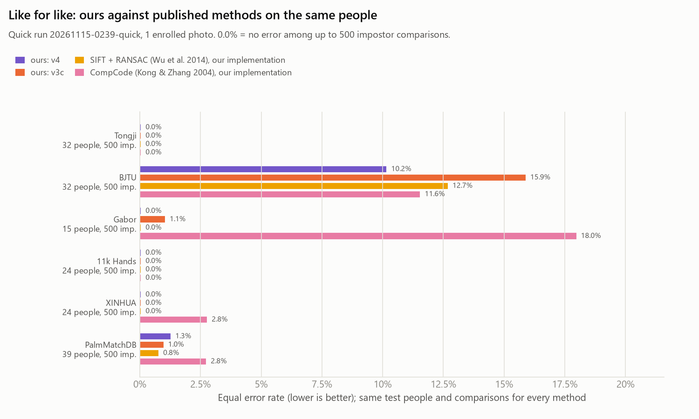
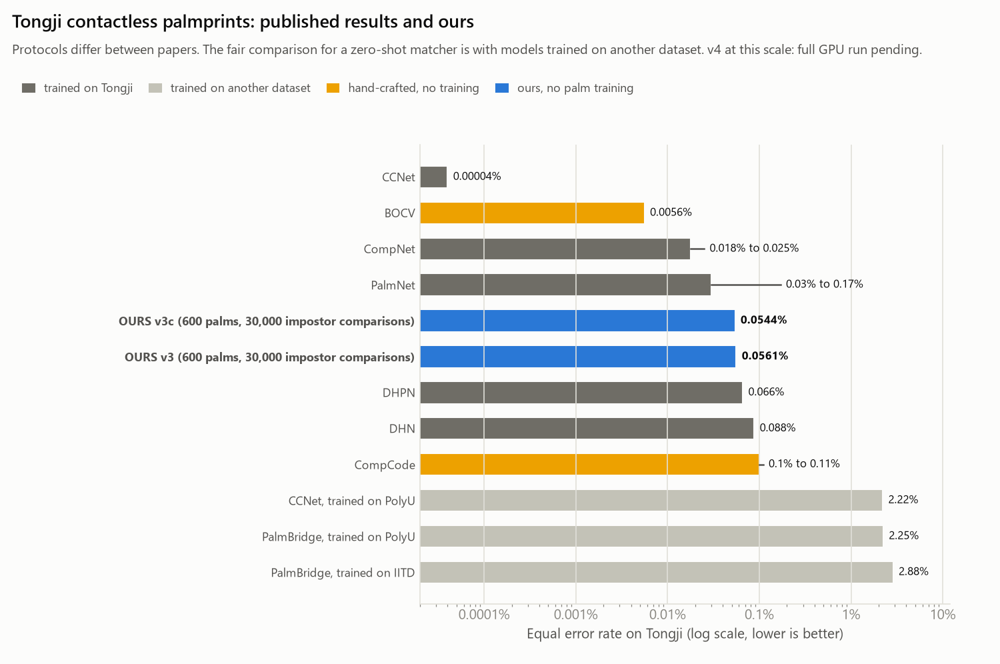

# v4 compared with the original benchmark

Generated by `benchmarks/compare_runs.py` from `runs\20261115-0239-quick` (v4 run), `runs\20261114-1759-quick` (original quick benchmark, 14 Nov) and `benchmark_results.csv` (original large benchmark, 13 Nov). EER does not depend on the threshold; FRR includes photos a quality gate sent back (failure to enrol). Lower is better everywhere.

## 1. Like for like: v3c and v4 on the same test identities

Same run, same photos, same comparisons. This is the fair measure of what the changes did.

| Dataset | Test identities | v3c EER | v4 EER | EER change | v3c FRR | v4 FRR | FRR change | v4 retake requests | FAR (both) |
|---|---|---|---|---|---|---|---|---|---|
| Tongji | 32 | 0.00% | **0.00%** | same | 0.0% | **0.0%** | same | 0.0% | 0.00% / 0.00% |
| BJTU | 32 | 15.90% | **10.18%** | better by 5.73 pts | 41.4% | **25.0%** | better by 16.41 pts | 0.0% | 0.00% / 0.00% |
| Gabor | 15 | 1.06% | **0.00%** | better by 1.06 pts | 5.6% | **0.0%** | better by 5.56 pts | 0.0% | 0.00% / 0.00% |
| 11k Hands | 24 | 0.00% | **0.00%** | same | 0.0% | **2.2%** | worse by 2.22 pts | 2.2% | 0.00% / 0.00% |
| XINHUA | 24 | 0.00% | **0.00%** | same | 0.0% | **3.3%** | worse by 3.33 pts | 3.3% | 0.00% / 0.00% |
| PalmMatchDB | 39 | 0.99% | **1.29%** | worse by 0.30 pts | 5.5% | **21.8%** | worse by 16.33 pts | 20.9% | 0.00% / 0.00% |
| Own photos | 2 | 0.00% | **0.00%** | same | 0.0% | **0.0%** | same | 0.0% | 0.00% / 0.00% |

Up to 500 impostor comparisons per dataset, so 0.00% means below about 0.6% (rule of 3).

## 2. Against the original quick benchmark (14 Nov)

The original run drew its own test identities, so these are **different people** from the v4 run (same datasets, same sample sizes). Read it as context, not as a like-for-like result.

| Dataset | v3c EER (original) | v3cr EER (original) | v2 EER (original) | **v4 EER (new)** | v3c FRR (original) | **v4 FRR (new)** |
|---|---|---|---|---|---|---|
| Tongji | 0.00% | 0.00% | 0.59% | **0.00%** | 0.0% | **0.0%** |
| BJTU | 13.84% | 12.65% | 7.13% | **10.18%** | 31.2% | **25.0%** |
| Gabor | 1.06% | 0.00% | 0.00% | **0.00%** | 5.6% | **0.0%** |
| 11k Hands | 0.00% | 0.00% | 0.00% | **0.00%** | 0.0% | **2.2%** |
| XINHUA | 0.10% | 0.00% | 0.10% | **0.00%** | 0.0% | **3.3%** |
| PalmMatchDB | 0.99% | 0.89% | 0.79% | **1.29%** | 5.5% | **21.8%** |
| Own photos | 0.00% | 0.00% | 0.00% | **0.00%** | 0.0% | **0.0%** |

## 3. Against the original large benchmark (13 Nov)

The large run used many more comparisons (Tongji: 600 palms, 5,400 genuine / 30,000 impostor). **v4 has not been run at this scale yet**: `.\bench.ps1 run --profile full` on the GPU desktop produces the like-for-like numbers.

| Dataset | Method | Identities | Genuine / impostor | EER | FRR |
|---|---|---|---|---|---|
| Tongji Contactless Palmprint | v3 | 600 | 5,400 / 30,000 | 0.06% | 0.13% |
| Tongji Contactless Palmprint | v3c | 600 | 5,400 / 30,000 | 0.05% | 0.09% |
| Tongji Contactless Palmprint | v2 | 600 | 5,400 / 30,000 | 0.44% | 0.57% |
| PalmMatchDB | v3 | 39 | 453 / 11,372 | 1.32% | 6.67% |
| PalmMatchDB | v3c | 39 | 453 / 11,372 | 1.11% | 6.46% |
| PalmMatchDB | v2 | 39 | 453 / 11,372 | 0.46% | 3.68% |
| Palmprint Image Dataset with Gabor Filter (raw images) | v3 | 15 | 311 / 4,942 | 0.29% | 2.89% |
| Palmprint Image Dataset with Gabor Filter (raw images) | v3c | 15 | 311 / 4,942 | 0.32% | 2.25% |
| Palmprint Image Dataset with Gabor Filter (raw images) | v2 | 15 | 311 / 4,942 | 0.00% | 0.00% |
| Own phone photos | v3 | 2 | 3 / 3 | 0.00% | 0.00% |
| Own phone photos | v3c | 2 | 3 / 3 | 0.00% | 0.00% |
| Own phone photos | v3cr | 2 | 3 / 3 | 0.00% | 0.00% |
| Own phone photos | v2 | 2 | 3 / 3 | 0.00% | 0.00% |
| Own phone photos | v1 | 2 | 3 / 3 | 33.33% | 100.00% |

## 4. Robustness (Tongji, clean enrolled photo vs degraded probe)

FRR, threshold as shipped. Original: 14 Nov quick run (20 palms). New: 20 Tongji TEST palms. For v4 the share sent back for a retake is in brackets; none of the photos v4 accepted was falsely rejected under any condition except rotation.

| Condition | v3c (original) | v3cr (original) | v3c (new) | **v4 (new)** |
|---|---|---|---|---|
| clean (baseline) | 0% | 0% | 0% | **0%** |
| darker (x0.5) | 0% | 0% | 0% | **0%** |
| brighter (x1.5) | 5% | 5% | 10% | **45% (45% retake)** |
| uneven light (gradient) | 0% | 0% | 0% | **0%** |
| overexposed (x2.0, clipped) | 50% | 50% | 60% | **65% (65% retake)** |
| hard shadow (half palm x0.4) | 0% | 0% | 0% | **0%** |
| blur (sigma 4) | 0% | 0% | 0% | **0%** |
| rotation 20 deg | 5% | 0% | 5% | **5%** |
| sensor noise (sigma 12) | 55% | 0% | 50% | **0%** |
| JPEG quality 20 | 5% | 0% | 5% | **0%** |

## 5. Speed

| Stage | Original, desktop GPU (13 Nov) | Original, desktop CPU (13 Nov) | New, this laptop CPU |
|---|---|---|---|
| Hand detection | – | 35 ms | 63 ms |
| Make template | 14 ms (DISK) | 184 ms (DISK) | v3c 1,203 ms, v4 1,383 ms |
| One comparison | v3c 21 ms | v3c 150 ms | v3c 410 ms, v4 589 ms |

The laptop CPU is several times slower than the desktop. v4 adds about 15% to template creation (SIFT part) and about 45% to a comparison. The full run on the desktop measures v4 on the GPU; a faster variant (384 px, 512 keypoints) halves template time with the same DEV accuracy (`speed/`).

## 6. What the system can do now that it could not before

| Capability | Original | Now | Measured |
|---|---|---|---|
| Spoof detection | none | random finger-count liveness + screen/print check | replayed video passes 0-2.7% (simulated); genuine photos flagged 2.9%; simulated screen/print accepted 5.0% / 9.3%; real attacks not collected yet |
| 1:N identification | none (1:1 only) | protected-vector shortlist + matcher | 240 palms: misses 2.67%, wrong person 0% |
| Template protection | raw templates | cancellable IoM search template + encrypted keypoint templates | D_sys 0.035; a re-issued template does not match the old one |
| Capture quality | blur and distance only | exposure, focus, faint creases, palm size, tilt, open hand, with a retake instruction | limits set on DEV photos |
| Product | comparison dashboard | kiosk: register, automatic palm ID, duplicate check, pay, admin, audit log | end-to-end tests |

## 7. Against published methods on the same datasets

Charts made by `benchmarks/plot_literature.py`.

**Like for like** (`plots/like_for_like.png`): two published methods re-implemented in `palm_match.py` and run on exactly the same test people and comparisons as v4: CompCode (Kong & Zhang 2004, our v1) and SIFT + RANSAC (Wu, Zhao & Bu 2014, our v2). v4 has the lowest or equal EER on every dataset except PalmMatchDB, where SIFT is lower (0.8% vs 1.3%). On BJTU: v4 10.2%, CompCode 11.6%, SIFT 12.7%, v3c 15.9%.

**Published numbers** (`plots/literature_tongji.png`): only Tongji has published results we could find. No published palm results were found for PalmMatchDB, the Gabor set, 11k Hands (palm side) or BJTU v2; the paper introducing XINHUA (PeerJ CS 2025) could not be retrieved. On Tongji, our zero-shot v3c (0.054%, 600 palms) is about 40x below models trained on another dataset (2.2-2.9%), below hand-crafted CompCode (0.10%) and similar to several models trained on Tongji itself (DHPN 0.066%, PalmNet 0.03-0.17%); CCNet, CompNet and BOCV trained or tuned on Tongji are lower. Protocols differ between papers.

## 8. Bottom line

- On the same people, v4 lowers the error where v3c was weak (BJTU, Gabor) and removes the noise and JPEG failures, at the cost of more retake requests (PalmMatchDB: 21% of photos sent back).
- Where v3c was already at 0%, v4 stays at 0%: the quick test cannot show smaller differences.
- The quick runs are small. The full GPU run gives the numbers to quote and the GPU latency.
