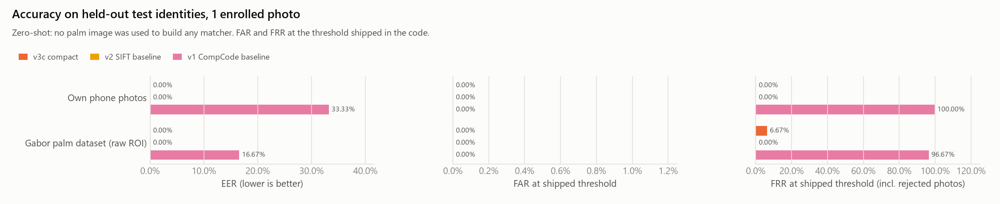
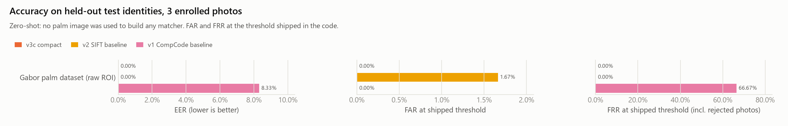
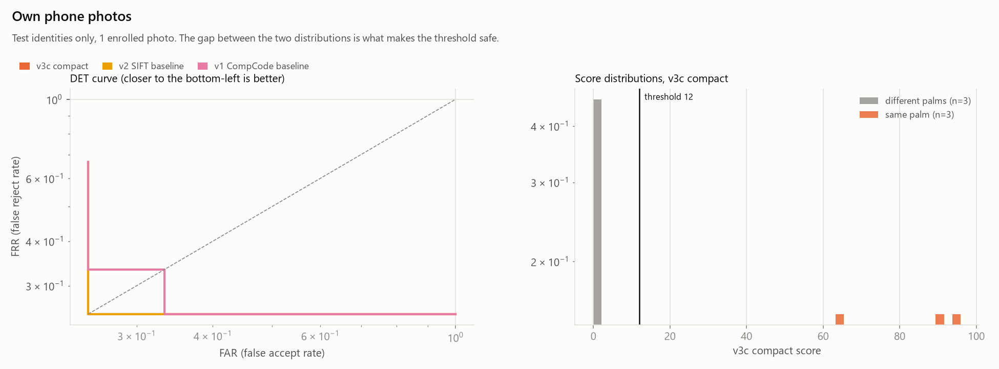
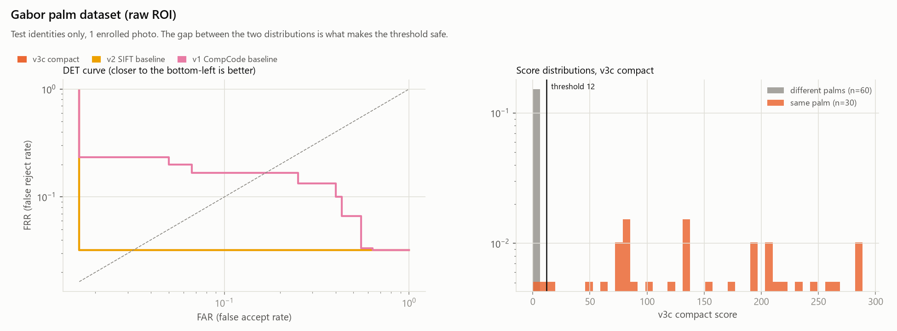
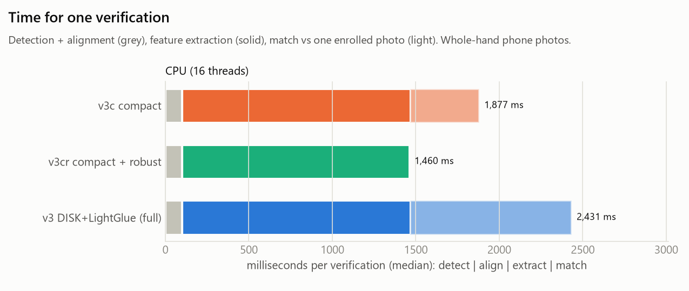
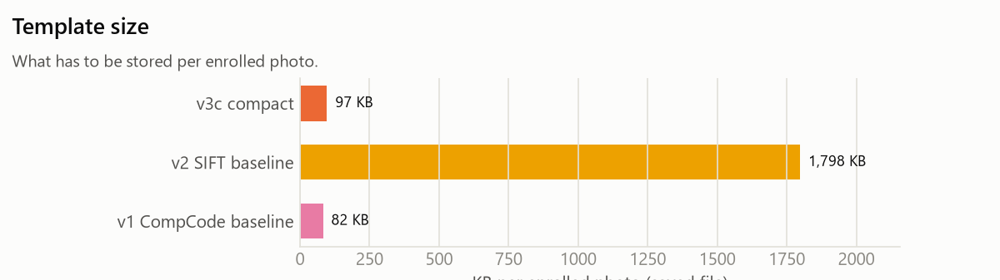

# Palm recognition benchmark (zero-shot)

Run `20261114-1749-quick`, finished 2026-11-14T17:57:03, on CPU (16 threads), profile **quick**.

No palm image was used to build any matcher: DISK and LightGlue are pretrained on outdoor scenes and MediaPipe only locates the hand. Every number below is measured on **held-out test identities**; for datasets with at least 40 identities, 20% of identities (DEV) were used only to pick the alternative thresholds.

## 1. Summary (1 enrolled photo, shipped threshold)

| Dataset | Method | Test identities | Comparisons (genuine / impostor) | Accuracy | EER | FAR | FRR | TAR @ FAR 0.1% | Rank-1 | FTE |
|---|---|---|---|---|---|---|---|---|---|---|
| Own phone photos | v3c compact | 2 | 3 / 3 | 100.00% | **0.00%** | 0.00% | 0.00% | n/a | n/a | 0.00% |
| Own phone photos | v2 SIFT baseline | 2 | 3 / 3 | 100.00% | **0.00%** | 0.00% | 0.00% | n/a | n/a | 0.00% |
| Own phone photos | v1 CompCode baseline | 2 | 3 / 3 | 50.00% | **33.33%** | 0.00% | 100.00% | n/a | n/a | 0.00% |
| Gabor palm dataset (raw ROI) | v3c compact | 15 | 30 / 60 | 97.78% | **0.00%** | 0.00% | 6.67% | n/a | n/a | 0.00% |
| Gabor palm dataset (raw ROI) | v2 SIFT baseline | 15 | 30 / 60 | 100.00% | **0.00%** | 0.00% | 0.00% | n/a | n/a | 0.00% |
| Gabor palm dataset (raw ROI) | v1 CompCode baseline | 15 | 30 / 60 | 67.78% | **16.67%** | 0.00% | 96.67% | n/a | n/a | 0.00% |

### With 3 enrolled photos (score = best match over the enrolled photos)

| Dataset | Method | Comparisons | Accuracy | EER | FAR | FRR |
|---|---|---|---|---|---|---|
| Gabor palm dataset (raw ROI) | v3c compact | 15 / 60 | 100.00% | **0.00%** | 0.00% | 0.00% |
| Gabor palm dataset (raw ROI) | v2 SIFT baseline | 15 / 60 | 98.67% | **0.00%** | 1.67% | 0.00% |
| Gabor palm dataset (raw ROI) | v1 CompCode baseline | 15 / 60 | 86.67% | **8.33%** | 0.00% | 66.67% |

## 2. Datasets and licences

| Dataset | Licence | Use here | Images used | Identities | Protocol | Hand detection |
|---|---|---|---|---|---|---|
| Own phone photos | own photos | own data | 4 (4 usable) | 2 | all-vs-all | MediaPipe |
| Gabor palm dataset (raw ROI) | CC BY 4.0 | permissive | 60 (60 usable) | 15 | all-vs-all | no (pre-cropped) |

`permissive` = licence allows research, development and redistribution. `eval-only` = no licence, research-only or unclear provenance: used only to measure a matcher that never trained on it, never redistributed. Notes per dataset are in `datasets.csv` (from `data/MANIFEST.json`).

## 4. Latency per verification (median, ms)

| Stage | CPU (16 threads) |
|---|---|
| detect | 98 (p95 323) |
| align | 2 (p95 18) |
| extract_v3 | 1,366 (p95 1,434) |
| extract_v3c | 1,365 (p95 1,468) |
| extract_v3cr | 1,359 (p95 1,432) |
| match_v3 | 965 (p95 1,479) |
| match_v3c | 412 (p95 622) |

Total for one verification = detect + align + extract + one match per enrolled photo. Measured on whole-hand phone photos. Not measured on a phone or payment terminal.

## 5. Template size (one enrolled photo, saved file)

| Method | Size |
|---|---|
| v3c compact | 97 KB |
| v2 SIFT baseline | 1,798 KB |
| v1 CompCode baseline | 82 KB |

## 6. Spoof detection

**Not measured.** The matchers have no liveness or presentation-attack detection yet, and no permissively licensed palm spoof dataset was found. A printed photo or a phone screen showing a palm may be accepted. Measuring APCER / BPCER (ISO/IEC 30107-3) needs our own spoof captures.

## 7. Comparison with published results

Published numbers are copied from the cited sources (not re-run) and use different protocols; most methods train on the dataset they are tested on. Ours is zero-shot.

| Dataset | Method | EER | Trained on palm images | Protocol | Source |
|---|---|---|---|---|---|
| Tongji | CCNet | 0.00004% | yes, on Tongji | closed-set, train and test split of Tongji | survey arXiv:2501.01166; arXiv:2504.11306 |
| Tongji | BOCV | 0.0056% | no (hand-crafted) | within Tongji | survey tables found in the literature search |
| Tongji | CompNet | 0.018 to 0.025% | yes, on Tongji | closed-set | arXiv:2501.01166 (0.018); arXiv:2504.11306 (0.025) |
| Tongji | PalmNet | 0.03 to 0.17% | partly (Gabor/PCA filters tuned on palms) | within Tongji | survey tables found in the literature search |
| Tongji | DHPN | 0.066% | yes | within Tongji | survey tables found in the literature search |
| Tongji | DHN | 0.088% | yes | within Tongji | survey tables found in the literature search |
| Tongji | CompCode | 0.10 to 0.11% | no (hand-crafted) | within Tongji | arXiv:2504.11306 and survey tables |
| Tongji | CCNet, trained on PolyU | 2.22% | yes, on another dataset | cross-dataset (PolyU to Tongji) | survey arXiv:2501.01166 |
| Tongji | PalmBridge, trained on PolyU | 2.25% | yes, on another dataset | cross-dataset open-set | arXiv:2601.20351 |
| Tongji | PalmBridge, trained on IITD | 2.88% | yes, on another dataset | cross-dataset open-set | arXiv:2601.20351 |
| PalmMatchDB | no published EER found | - |  | The dataset paper (Alausa et al., ICPECA 2023, IEEE Xplore 10076097) is paywalled; its results could not be read. No other paper reporting on this dataset was found. | web search, 2026-11-13 |
| Palmprint Image Dataset with Gabor Filter | no published result found | - |  | Mendeley Data record only; no paper reporting verification results on it was found. | web search, 2026-11-13 |

## 8. How far the numbers can be trusted

- Comparison counts are in the tables. With N impostor comparisons a FAR below about 3/N cannot be shown (rule of 3); the largest test here has 60.
- Fewer than 20 test identities (smoke test only, not an accuracy measurement): Gabor palm dataset (raw ROI), Own phone photos.
- Tongji, BJTU, XINHUA and Gabor are pre-cropped palms, so they do not test hand detection and alignment; PalmMatchDB, 11k Hands and the own photos test the whole chain.
- PalmMatchDB labels are unreliable; only pairs with trustworthy labels are kept (same palm: photos < 10 min apart; different palm: > 1 day apart).
- **Quick profile**: small samples sized for a laptop CPU. Run `--profile full` on the GPU machine for the numbers to quote.

## 9. Files

- `metrics.csv` every metric, one row per dataset x method x enrolment; `latency.csv`, `robustness.csv`, `datasets.csv`
- `scores/*.npz` the score of every comparison; `jobs/*.json` raw results; `run.log` the full log
- `plots/accuracy_enrol1.png`
- `plots/accuracy_enrol3.png`
- `plots/det_real.png`
- `plots/det_gabor.png`
- `plots/latency.png`
- `plots/template_size.png`

