# Palm recognition benchmark (zero-shot)

Run `20261115-0239-quick`, finished 2026-11-15T14:13:59, on CPU (16 threads), profile **quick**.

No palm image was used to build any matcher: DISK and LightGlue are pretrained on outdoor scenes and MediaPipe only locates the hand. Every number below is measured on **held-out test identities**; for datasets with at least 40 identities, 20% of identities (DEV) were used only to pick the alternative thresholds.

## 1. Summary (1 enrolled photo, shipped threshold)

| Dataset | Method | Test identities | Comparisons (genuine / impostor) | Accuracy | EER | FAR | FRR | TAR @ FAR 0.1% | Rank-1 | FTE |
|---|---|---|---|---|---|---|---|---|---|---|
| Tongji contactless (ROI) | v4 (v3c + quality gate, DEV-tuned) | 32 | 128 / 500 | 100.00% | **0.00%** | 0.00% | 0.00% | n/a | n/a | 0.00% |
| Tongji contactless (ROI) | v3c compact | 32 | 128 / 500 | 100.00% | **0.00%** | 0.00% | 0.00% | n/a | n/a | 0.00% |
| Tongji contactless (ROI) | v2 SIFT baseline | 32 | 128 / 500 | 100.00% | **0.00%** | 0.00% | 0.00% | n/a | n/a | 0.00% |
| Tongji contactless (ROI) | v1 CompCode baseline | 32 | 128 / 500 | 79.78% | **0.00%** | 0.00% | 99.22% | n/a | n/a | 0.00% |
| PalmMatchDB (phone photos) | v4 (v3c + quality gate, DEV-tuned) | 39 | 85 / 500 | 99.83% | **1.29%** | 0.00% | 21.80% | n/a | n/a | 20.87% |
| PalmMatchDB (phone photos) | v3c compact | 39 | 102 / 500 | 99.50% | **0.99%** | 0.00% | 5.47% | n/a | n/a | 2.61% |
| PalmMatchDB (phone photos) | v2 SIFT baseline | 39 | 102 / 500 | 99.34% | **0.79%** | 0.58% | 3.56% | n/a | n/a | 2.61% |
| PalmMatchDB (phone photos) | v1 CompCode baseline | 39 | 74 / 500 | 95.82% | **2.75%** | 0.00% | 52.41% | n/a | n/a | 29.57% |
| 11k Hands (palmar photos) | v4 (v3c + quality gate, DEV-tuned) | 24 | 69 / 500 | 100.00% | **0.00%** | 0.00% | 2.22% | n/a | n/a | 2.22% |
| 11k Hands (palmar photos) | v3c compact | 24 | 72 / 500 | 100.00% | **0.00%** | 0.00% | 0.00% | n/a | n/a | 0.00% |
| 11k Hands (palmar photos) | v2 SIFT baseline | 24 | 72 / 500 | 99.65% | **0.00%** | 0.40% | 0.00% | n/a | n/a | 0.00% |
| 11k Hands (palmar photos) | v1 CompCode baseline | 24 | 72 / 500 | 95.98% | **0.00%** | 0.00% | 31.94% | n/a | n/a | 0.00% |
| BJTU palm v2 (ROI) | v4 (v3c + quality gate, DEV-tuned) | 32 | 128 / 500 | 94.90% | **10.18%** | 0.00% | 25.00% | n/a | n/a | 0.00% |
| BJTU palm v2 (ROI) | v3c compact | 32 | 128 / 500 | 91.56% | **15.90%** | 0.00% | 41.41% | n/a | n/a | 0.00% |
| BJTU palm v2 (ROI) | v2 SIFT baseline | 32 | 128 / 500 | 94.90% | **12.70%** | 0.00% | 25.00% | n/a | n/a | 0.00% |
| BJTU palm v2 (ROI) | v1 CompCode baseline | 32 | 128 / 500 | 79.94% | **11.56%** | 0.00% | 98.44% | n/a | n/a | 0.00% |
| XINHUA (ROI) | v4 (v3c + quality gate, DEV-tuned) | 24 | 67 / 500 | 100.00% | **0.00%** | 0.00% | 3.33% | n/a | n/a | 3.33% |
| XINHUA (ROI) | v3c compact | 24 | 72 / 500 | 100.00% | **0.00%** | 0.00% | 0.00% | n/a | n/a | 0.00% |
| XINHUA (ROI) | v2 SIFT baseline | 24 | 72 / 500 | 100.00% | **0.00%** | 0.00% | 0.00% | n/a | n/a | 0.00% |
| XINHUA (ROI) | v1 CompCode baseline | 24 | 72 / 500 | 89.69% | **2.79%** | 0.00% | 81.94% | n/a | n/a | 0.00% |
| Gabor palm dataset (raw ROI) | v4 (v3c + quality gate, DEV-tuned) | 15 | 90 / 500 | 100.00% | **0.00%** | 0.00% | 0.00% | n/a | n/a | 0.00% |
| Gabor palm dataset (raw ROI) | v3c compact | 15 | 90 / 500 | 99.15% | **1.06%** | 0.00% | 5.56% | n/a | n/a | 0.00% |
| Gabor palm dataset (raw ROI) | v2 SIFT baseline | 15 | 90 / 500 | 99.66% | **0.00%** | 0.40% | 0.00% | n/a | n/a | 0.00% |
| Gabor palm dataset (raw ROI) | v1 CompCode baseline | 15 | 90 / 500 | 86.44% | **17.99%** | 0.00% | 88.89% | n/a | n/a | 0.00% |
| Own phone photos | v4 (v3c + quality gate, DEV-tuned) | 2 | 3 / 3 | 100.00% | **0.00%** | 0.00% | 0.00% | n/a | n/a | 0.00% |
| Own phone photos | v3c compact | 2 | 3 / 3 | 100.00% | **0.00%** | 0.00% | 0.00% | n/a | n/a | 0.00% |
| Own phone photos | v2 SIFT baseline | 2 | 3 / 3 | 100.00% | **0.00%** | 0.00% | 0.00% | n/a | n/a | 0.00% |
| Own phone photos | v1 CompCode baseline | 2 | 3 / 3 | 50.00% | **33.33%** | 0.00% | 100.00% | n/a | n/a | 0.00% |

### With 3 enrolled photos (score = best match over the enrolled photos)

| Dataset | Method | Comparisons | Accuracy | EER | FAR | FRR |
|---|---|---|---|---|---|---|
| Gabor palm dataset (raw ROI) | v4 (v3c + quality gate, DEV-tuned) | 15 / 210 | 100.00% | **0.00%** | 0.00% | 0.00% |
| Gabor palm dataset (raw ROI) | v3c compact | 15 / 210 | 100.00% | **0.00%** | 0.00% | 0.00% |
| Gabor palm dataset (raw ROI) | v2 SIFT baseline | 15 / 210 | 98.67% | **0.00%** | 1.43% | 0.00% |
| Gabor palm dataset (raw ROI) | v1 CompCode baseline | 15 / 210 | 95.56% | **6.67%** | 0.00% | 66.67% |

### Thresholds chosen on DEV identities, applied to TEST identities

| Dataset | Method | shipped thr | FAR / FRR | DEV EER-point thr | FAR / FRR | DEV FAR-0.1% thr | FAR / FRR |
|---|---|---|---|---|---|---|---|
| Tongji contactless (ROI) | v4 (v3c + quality gate, DEV-tuned) | 1.5 | 0.00% / 0.00% | 8.7 | 0.00% / 3.91% | 17.1 | 0.00% / 21.88% |
| Tongji contactless (ROI) | v3c compact | 12 | 0.00% / 0.00% | 96.3 | 0.00% / 1.56% | 189.6 | 0.00% / 18.75% |
| Tongji contactless (ROI) | v2 SIFT baseline | 4 | 0.00% / 0.00% | 15.0 | 0.00% / 3.91% | 30.0 | 0.00% / 15.62% |
| Tongji contactless (ROI) | v1 CompCode baseline | -0.3 | 0.00% / 99.22% | -0.6 | 0.00% / 0.00% | -0.5 | 0.00% / 7.81% |
| 11k Hands (palmar photos) | v4 (v3c + quality gate, DEV-tuned) | 1.5 | 0.00% / 2.22% | 9.2 | 0.00% / 10.72% | 18.1 | 0.00% / 20.64% |
| 11k Hands (palmar photos) | v3c compact | 12 | 0.00% / 0.00% | 105.2 | 0.00% / 5.56% | 209.2 | 0.00% / 19.44% |
| 11k Hands (palmar photos) | v2 SIFT baseline | 4 | 0.40% / 0.00% | 86.5 | 0.00% / 8.33% | 168.0 | 0.00% / 18.06% |
| 11k Hands (palmar photos) | v1 CompCode baseline | -0.3 | 0.00% / 31.94% | -0.6 | 0.00% / 0.00% | -0.5 | 0.00% / 1.39% |
| BJTU palm v2 (ROI) | v4 (v3c + quality gate, DEV-tuned) | 1.5 | 0.00% / 25.00% | 0.1 | 8.00% / 12.50% | 1.0 | 0.60% / 21.09% |
| BJTU palm v2 (ROI) | v3c compact | 12 | 0.00% / 41.41% | 0.2 | 21.20% / 14.84% | 3.6 | 0.00% / 34.38% |
| BJTU palm v2 (ROI) | v2 SIFT baseline | 4 | 0.00% / 25.00% | 4.0 | 0.00% / 25.00% | 4.0 | 0.00% / 25.00% |
| BJTU palm v2 (ROI) | v1 CompCode baseline | -0.3 | 0.00% / 98.44% | -0.7 | 0.60% / 25.78% | -0.6 | 0.20% / 41.41% |
| XINHUA (ROI) | v4 (v3c + quality gate, DEV-tuned) | 1.5 | 0.00% / 3.33% | 5.0 | 0.00% / 4.78% | 9.9 | 0.00% / 9.10% |
| XINHUA (ROI) | v3c compact | 12 | 0.00% / 0.00% | 70.3 | 0.00% / 4.17% | 139.6 | 0.00% / 8.33% |
| XINHUA (ROI) | v2 SIFT baseline | 4 | 0.00% / 0.00% | 26.0 | 0.00% / 0.00% | 49.0 | 0.00% / 4.17% |
| XINHUA (ROI) | v1 CompCode baseline | -0.3 | 0.00% / 81.94% | -0.6 | 0.00% / 6.94% | -0.5 | 0.00% / 15.28% |

## 2. Datasets and licences

| Dataset | Licence | Use here | Images used | Identities | Protocol | Hand detection |
|---|---|---|---|---|---|---|
| Tongji contactless (ROI) | none stated on the official page | eval-only | 160 (160 usable) | 40 | cross-session | no (pre-cropped) |
| PalmMatchDB (phone photos) | Apache-2.0 (Hugging Face dataset tag) | permissive | 115 (91 usable) | 39 | all-vs-all (trusted-label pairs) | MediaPipe |
| 11k Hands (palmar photos) | free for reasonable academic fair use (project page) | eval-only | 90 (88 usable) | 30 | all-vs-all | MediaPipe |
| BJTU palm v2 (ROI) | CC BY 4.0 on the Zenodo record, but the images are re-hosted copies of other databases | eval-only | 160 (160 usable) | 40 | cross-session | no (pre-cropped) |
| XINHUA (ROI) | CC BY 4.0 on the Zenodo record, but the images are re-hosted copies of other databases | eval-only | 90 (87 usable) | 30 | all-vs-all | no (pre-cropped) |
| Gabor palm dataset (raw ROI) | CC BY 4.0 | permissive | 60 (60 usable) | 15 | all-vs-all | no (pre-cropped) |
| Own phone photos | own photos | own data | 4 (4 usable) | 2 | all-vs-all | MediaPipe |

`permissive` = licence allows research, development and redistribution. `eval-only` = no licence, research-only or unclear provenance: used only to measure a matcher that never trained on it, never redistributed. Notes per dataset are in `datasets.csv` (from `data/MANIFEST.json`).

## 3. Robustness to capture conditions (Tongji, simulated)

Clean enrolled photo, degraded probe photo; 20 genuine and 80 impostor comparisons per condition, shipped threshold. FRR / FAR:

| Condition | v4 (v3c + quality gate, DEV-tuned) | v3c compact |
|---|---|---|
| clean (baseline) | 0.0% / 0.0% | 0.0% / 0.0% |
| darker (x0.5) | 0.0% / 0.0% | 0.0% / 0.0% |
| brighter (x1.5) | 45.0% / 0.0% (45.0% retake) | 10.0% / 0.0% |
| uneven light (gradient) | 0.0% / 0.0% | 0.0% / 0.0% |
| overexposed (x2.0, clipped) | 65.0% / 0.0% (65.0% retake) | 60.0% / 0.0% |
| hard shadow (half palm x0.4) | 0.0% / 0.0% | 0.0% / 0.0% |
| blur (sigma 4) | 0.0% / 0.0% | 0.0% / 0.0% |
| rotation 20 deg | 5.0% / 0.0% | 5.0% / 0.0% |
| sensor noise (sigma 12) | 0.0% / 0.0% | 50.0% / 0.0% |
| JPEG quality 20 | 0.0% / 0.0% | 5.0% / 0.0% |

Degradations are applied to the cropped image, not captured with a real camera. For v4, FRR counts every genuine attempt that did not pass, including photos its quality gate sent back for a retake (in brackets); a live system asks those users to retake the photo instead of rejecting them.

## 4. Latency per verification (median, ms)

| Stage | CPU (16 threads) |
|---|---|
| detect | 63 (p95 64) |
| align | 2 (p95 27) |
| extract_v4 | 1,383 (p95 1,417) |
| extract_v3 | 1,210 (p95 1,258) |
| extract_v3c | 1,203 (p95 1,247) |
| extract_v3cr | 1,256 (p95 1,264) |
| match_v4 | 589 (p95 643) |
| match_v3 | 926 (p95 1,242) |
| match_v3c | 410 (p95 552) |
| match_v3cr | 389 (p95 539) |

Total for one verification = detect + align + extract + one match per enrolled photo. Measured on whole-hand phone photos. Not measured on a phone or payment terminal.

## 5. Template size (one enrolled photo, saved file)

| Method | Size |
|---|---|
| v4 (v3c + quality gate, DEV-tuned) | 235 KB |
| v3c compact | 97 KB |
| v2 SIFT baseline | 695 KB |
| v1 CompCode baseline | 82 KB |

## 6. Spoof detection

**Not measured.** The matchers have no liveness or presentation-attack detection yet, and no permissively licensed palm spoof dataset was found. A printed photo or a phone screen showing a palm may be accepted. Measuring APCER / BPCER (ISO/IEC 30107-3) needs our own spoof captures.

## 7. Comparison with published results

Published numbers are copied from the cited sources (not re-run) and use different protocols; most methods train on the dataset they are tested on. Ours is zero-shot.

| Dataset | Method | EER | Trained on palm images | Protocol | Source |
|---|---|---|---|---|---|
| Tongji contactless (ROI) | **ours: v4 (v3c + quality gate, DEV-tuned)** | 0.00% | no (zero-shot) | cross-session, test identities | this run |
| Tongji contactless (ROI) | **ours: v3c compact** | 0.00% | no (zero-shot) | cross-session, test identities | this run |
| Tongji contactless (ROI) | **ours: v2 SIFT baseline** | 0.00% | no (zero-shot) | cross-session, test identities | this run |
| Tongji contactless (ROI) | **ours: v1 CompCode baseline** | 0.00% | no (zero-shot) | cross-session, test identities | this run |
| PalmMatchDB (phone photos) | **ours: v4 (v3c + quality gate, DEV-tuned)** | 1.29% | no (zero-shot) | all-vs-all (trusted-label pairs), test identities | this run |
| PalmMatchDB (phone photos) | **ours: v3c compact** | 0.99% | no (zero-shot) | all-vs-all (trusted-label pairs), test identities | this run |
| PalmMatchDB (phone photos) | **ours: v2 SIFT baseline** | 0.79% | no (zero-shot) | all-vs-all (trusted-label pairs), test identities | this run |
| PalmMatchDB (phone photos) | **ours: v1 CompCode baseline** | 2.75% | no (zero-shot) | all-vs-all (trusted-label pairs), test identities | this run |
| Tongji | CCNet | 0.00004% | yes, on Tongji | closed-set, train and test split of Tongji | survey arXiv:2501.01166; arXiv:2504.11306 |
| Tongji | BOCV | 0.0056% | no (hand-crafted) | within Tongji | survey tables found in the literature search |
| Tongji | CompNet | 0.018 to 0.025% | yes, on Tongji | closed-set | arXiv:2501.01166 (0.018); arXiv:2504.11306 (0.025) |
| Tongji | PalmNet | 0.03 to 0.17% | partly (Gabor/PCA filters tuned on palms) | within Tongji | survey tables found in the literature search |
| Tongji | DHPN | 0.066% | yes | within Tongji | survey tables found in the literature search |
| Tongji | DHN | 0.088% | yes | within Tongji | survey tables found in the literature search |
| Tongji | CompCode | 0.10 to 0.11% | no (hand-crafted) | within Tongji | arXiv:2504.11306 and survey tables |
| Tongji | CCNet, trained on PolyU | 2.22% | yes, on another dataset | cross-dataset (PolyU to Tongji) | survey arXiv:2501.01166 |
| Tongji | PalmBridge, trained on PolyU | 2.25% | yes, on another dataset | cross-dataset open-set | arXiv:2601.20351 |
| Tongji | PalmBridge, trained on IITD | 2.88% | yes, on another dataset | cross-dataset open-set | arXiv:2601.20351 |
| PalmMatchDB | no published EER found | - |  | The dataset paper (Alausa et al., ICPECA 2023, IEEE Xplore 10076097) is paywalled; its results could not be read. No other paper reporting on this dataset was found. | web search, 2026-11-13 |
| Palmprint Image Dataset with Gabor Filter | no published result found | - |  | Mendeley Data record only; no paper reporting verification results on it was found. | web search, 2026-11-13 |

## 8. How far the numbers can be trusted

- Comparison counts are in the tables. With N impostor comparisons a FAR below about 3/N cannot be shown (rule of 3); the largest test here has 500.
- Fewer than 20 test identities (smoke test only, not an accuracy measurement): Gabor palm dataset (raw ROI), Own phone photos.
- Tongji, BJTU, XINHUA and Gabor are pre-cropped palms, so they do not test hand detection and alignment; PalmMatchDB, 11k Hands and the own photos test the whole chain.
- 11k Hands, XINHUA and Gabor photos of a palm were taken in one sitting (same session), an easier test than Tongji and BJTU, whose two sessions are weeks apart.
- Accuracy depends on the mix of genuine and impostor comparisons (v3cr uses fewer impostor comparisons because it retries every failed one); compare methods on EER, FAR and FRR.
- PalmMatchDB labels are unreliable; only pairs with trustworthy labels are kept (same palm: photos < 10 min apart; different palm: > 1 day apart).
- Every reported identity is a TEST identity of the one global split (`global_split`). v4's settings (CLAHE, fusion, threshold 1.5, quality-gate limits) were chosen on DEV identities only (`benchmarks/results/tuning/DECISIONS.md`). The older thresholds were not: v3's 26 was set on Tongji and v3c's 12 on PalmMatchDB and the own photos, so their FAR/FRR on those sets are optimistic (EER does not depend on it).
- v4's FRR includes photos its quality gate sent back; in a live system the user would retake them.
- **Quick profile**: small samples sized for a laptop CPU. Run `--profile full` on the GPU machine for the numbers to quote.

## 9. Files

- `metrics.csv` every metric, one row per dataset x method x enrolment; `latency.csv`, `robustness.csv`, `datasets.csv`
- `scores/*.npz` the score of every comparison; `jobs/*.json` raw results; `run.log` the full log
- `plots/accuracy_enrol1.png`
- `plots/accuracy_enrol3.png`
- `plots/det_tongji.png`
- `plots/det_palmmatchdb.png`
- `plots/det_11khands.png`
- `plots/det_bjtu2.png`
- `plots/det_xinhua.png`
- `plots/det_gabor.png`
- `plots/det_real.png`
- `plots/latency.png`
- `plots/robustness.png`
- `plots/template_size.png`

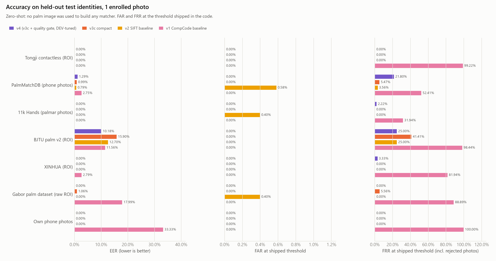

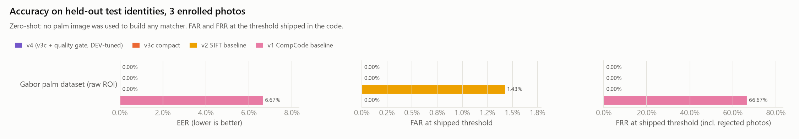

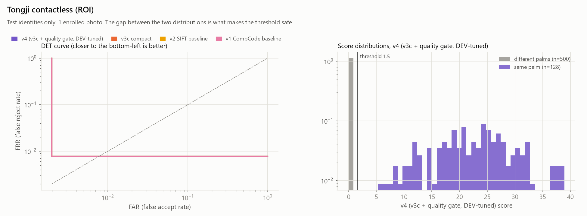

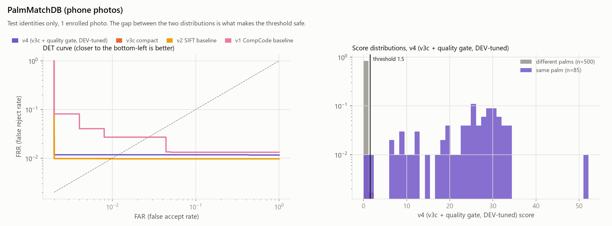

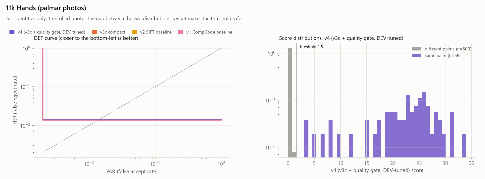

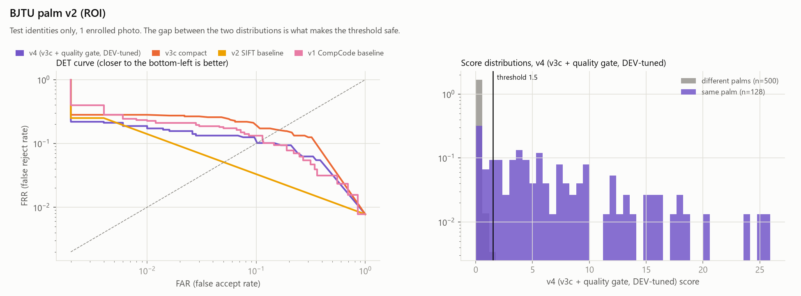

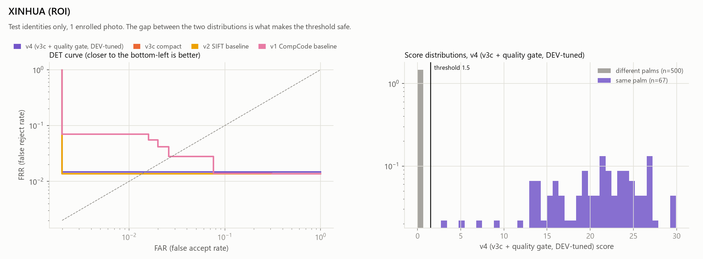

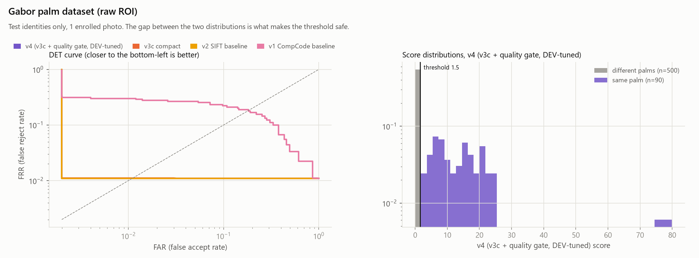

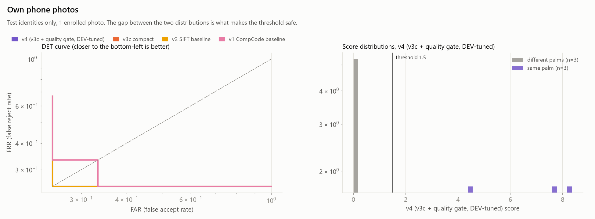

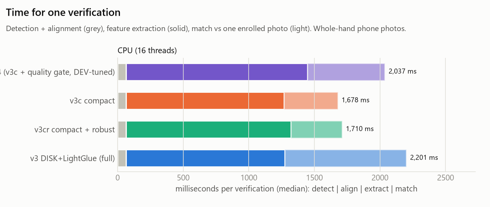

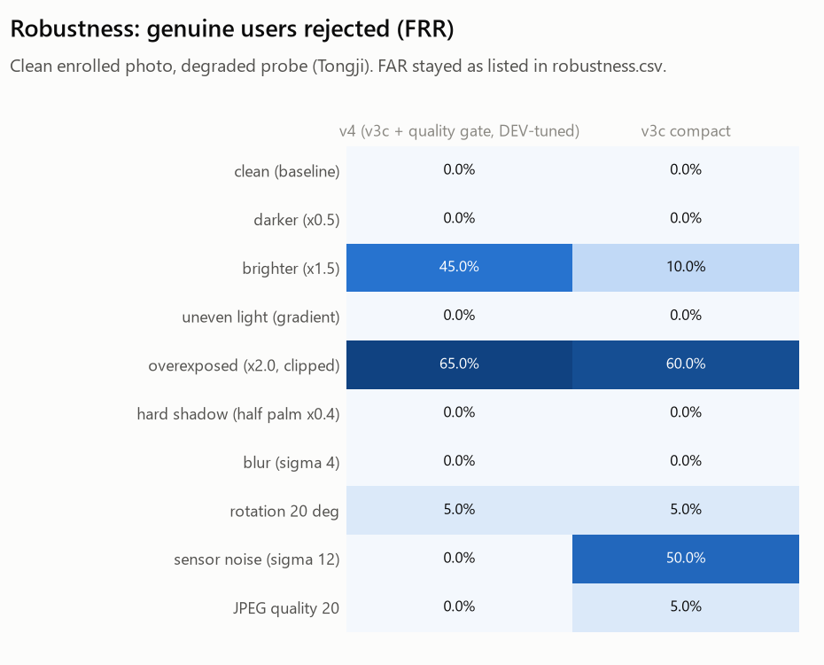

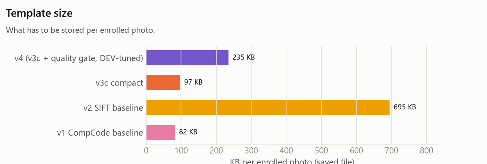
